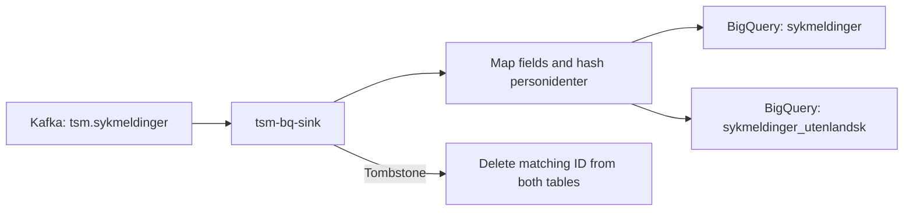

# tsm-bq-sink

A Kotlin/Ktor service that reads sykmeldinger from the Kafka topic
`tsm.sykmeldinger` and writes them to BigQuery for analysis.

- Maps nasjonale sykmeldinger to `tsm_kafka_sink.sykmeldinger` and
  utenlandske sykmeldinger to `tsm_kafka_sink.sykmeldinger_utenlandsk`.
- Hashes personidenter with HMAC-SHA256 before storing them.
- Deletes matching rows from both tables when a Kafka tombstone arrives.
- Applies BigQuery schema migrations on startup.

## Data flow



## Development with mise

[mise](https://mise.jdx.dev/) manages Java using `.mise.toml` (OpenJDK 25).
Gradle uses a Java 21 toolchain.

```sh
mise trust
mise install
./gradlew test
./gradlew build
```

Running the service requires Kafka configuration, Google Cloud credentials and
access to BigQuery, plus `NAIS_POD_NAME`, `IDENT_HASH_SECRET` and
`GCP_TEAM_PROJECT_ID`.
